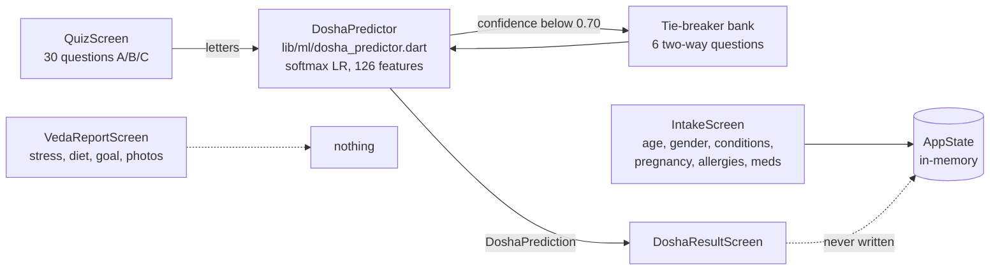
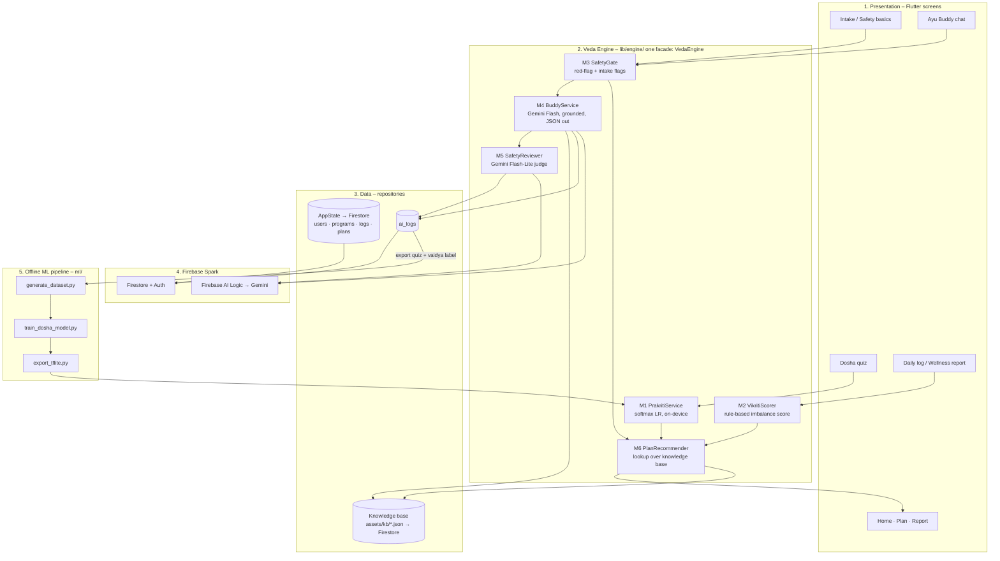
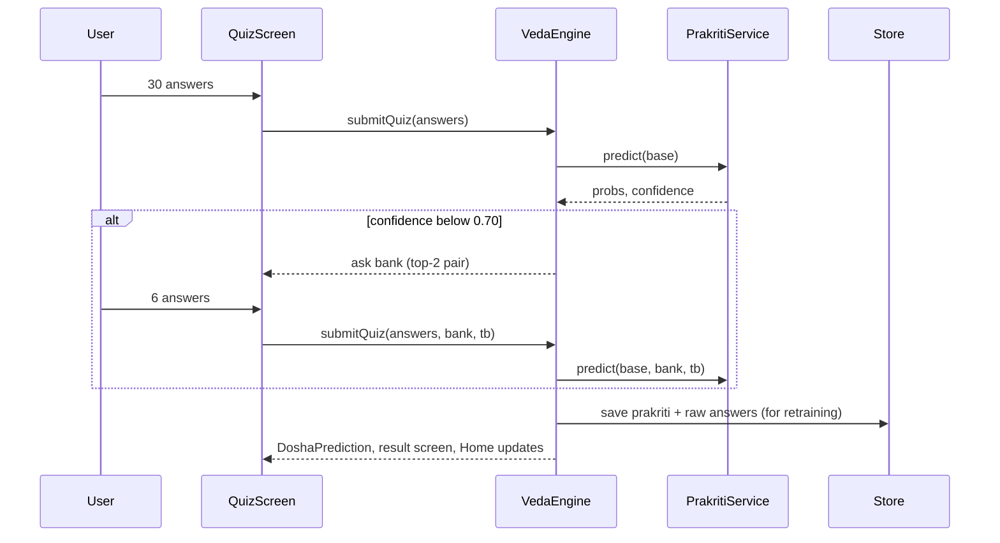
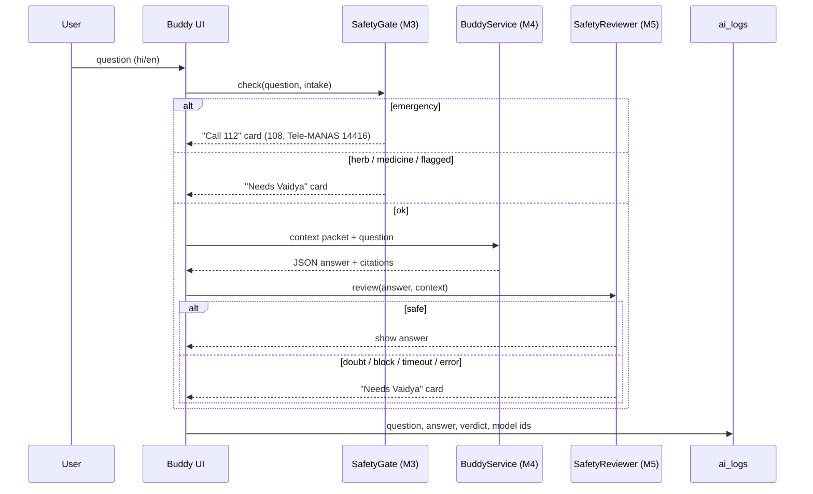

# VedaVerse – ML / AI Engine Architecture

Status: design, 2026-10-31. Covers what exists in the app today, what the
engine should become for the hackathon build, and the exact input / model /
output contract for every stage.

Hard rules that shape everything below (from the system design doc):

* The AI never diagnoses, prescribes or doses. It "spots signs" and
  "helps manage"; it never "identifies / reverses / cures".
* Every AI answer passes the 3-check guardrail (red-flag → grounded answer →
  safety reviewer). Any failure in the chain shows the "Needs Vaidya" card.
* Intake flags (pregnant, BP, diabetes, teen) route to a Vaidya before any
  diet / herb / routine change. Herb and medicine questions always go to a
  Vaidya.
* Infra stays on Firebase Spark (free tier). No API key in the app
  (Firebase AI Logic).

---

## 1. Where we are today (as-is)



What is solid and should be kept:

| Piece | Where | Keep? |
|---|---|---|
| 30-question Prakriti quiz + 3 tie-breaker banks | `lib/screens/quiz_screen.dart`, `ml/questions.py` | Yes |
| Softmax logistic-regression model (JSON + TFLite, identical numbers) | `assets/ml/dosha_model.json`, `ml/dist/` | Yes |
| Pure-Dart inference that runs on Web | `lib/ml/dosha_predictor.dart` | Yes |
| Training / export pipeline on synthetic data | `ml/*.py` | Yes |

Gaps the engine design fixes:

1. `AppState.prediction` is never set after the quiz, so Home / report show a placeholder mix.
2. Intake safety data is not consumed by any logic.
3. Daily log inputs (stress, sleep, diet, symptoms) have no scorer.
4. Ayu Buddy (Gemini) and the 3-check guardrail are not implemented.
5. Nothing is logged, so there is no path from synthetic to real training data.
6. `lib/app_shell.dart` is missing (imported by the intake screen), so the build is broken.

---

## 2. Target architecture (to-be)

Five layers. The **Engine** layer is new and is the only thing screens talk to
for anything "smart".



---

## 3. Inputs – where the engine takes data from

| # | Input | Screen | Fields | Feeds |
|---|---|---|---|---|
| I1 | Safety profile | Intake (4 steps) | age, gender, issues, since, conditions, pregnancy, allergies, medicines, consent flags | M3, M4 context, M6 |
| I2 | Prakriti quiz | Quiz | 30 answers (0/1/2) + optional bank id + 6 two-way answers | M1 |
| I3 | Daily log (Vikriti) | Wellness report / daily check-in | sleep hours, stress 0-4, digestion, energy, bowel, mood, cycle/symptom log for PCOS, diet prefs, goal | M2, M6 |
| I4 | Question | Ayu Buddy chat (text, Hindi/English, later voice) | free text | M3 → M4 → M5 |
| I5 | Program state | derived | phase (Samjho / Reset / Build / Review), week, season (Ritu), streak | M6 |
| I6 | Lab report photo (Review phase, roadmap) | Report upload | image | Gemini vision → Vaidya |

Rule: I1 and I2 are collected once and edited from Profile. I3 is collected
daily and is what makes the plan change over time. Health data (I1, I3, I6)
never leaves Firebase (never sent to Maps / Meet / YouTube).

---

## 4. Models – which engine does what, and why

| Model | Task | Choice | Why this and not an LLM |
|---|---|---|---|
| **M1 PrakritiService** | 30 (+6) answers → P(Vata, Pitta, Kapha) + type label | Existing multinomial logistic regression (JSON on web, same `.tflite` on native). 88.8 % / 89.8 % dominant-dosha accuracy on held-out synthetic data. | Tiny (13 KB), deterministic, explainable (per-question weights), works offline and on Flutter Web, no cost. An LLM would be slower, non-deterministic and unverifiable. |
| **M2 VikritiScorer** | daily log → imbalance score per dosha (0-1) + top 3 drivers | Rule-based weighted table (classical Ayurveda sign → dosha). Not ML yet. | No labelled data exists. Rules are reviewable by Dr. Lekha, which judges will ask about. Swap for a model once `logs` has months of data. |
| **M3 SafetyGate** | question / intake → `emergency` / `vaidya_only` / `ok` | On-device: red-flag keyword + regex list (chest pain, heavy bleeding, fainting, self-harm, high fever in pregnancy …) plus intake flags (pregnant, BP, diabetes, age under 18) plus a herb / medicine topic list. | Must work with no network and never depend on an LLM "noticing". Returns in under a millisecond. |
| **M4 BuddyService** | context packet + question → grounded answer | Gemini Flash via Firebase AI Logic, `responseSchema` JSON, temperature 0.2, system prompt with wording rules, knowledge-base chunks injected. | Only stage that needs language understanding. Flash is on the Spark free tier and fast enough for chat. |
| **M5 SafetyReviewer** | answer + context → `safe` / `needs_vaidya` / `block` | Second Gemini call (Flash-Lite is enough), separate judge prompt, JSON out. Timeout 8 s. | Independent reviewer catches prescriptions, doses, diagnosis words, scope drift. Any error → `needs_vaidya` (fail-safe). |
| **M6 PlanRecommender** | (prakriti type, vikriti top dosha, phase, season, flags) → plan item ids | Deterministic lookup over the curated knowledge base. The LLM may *phrase* the plan; it never *picks* herbs or items. | Keeps every recommendation traceable to a Vaidya-reviewed entry. |

Roadmap only: Gemini vision for lab-report extraction (I6), tongue photo,
Gemini Live voice.

---

## 5. Outputs – the engine contract

Every screen reads one object. Persist it in `users/{uid}/engine/latest` and
keep history in `logs`.

```jsonc
{
  "engine_version": "1.0",
  "computed_at": "2026-10-31T10:12:00+05:30",

  "prakriti": {                      // from M1, stable after quiz
    "model_version": 2,
    "probs": {"Vata": 0.58, "Pitta": 0.38, "Kapha": 0.04},
    "dominant": "Vata",
    "type": "Vata-Pitta",            // single | dual | Tridoshic
    "confidence": 0.58,
    "used_tiebreaker": true,
    "top_questions": ["Body Frame", "Body Weight", "Skin"]
  },

  "vikriti": {                       // from M2, changes daily
    "scores": {"Vata": 0.7, "Pitta": 0.3, "Kapha": 0.1},
    "aggravated": "Vata",
    "drivers": ["sleep under 6h", "stress 4/4", "irregular meals"]
  },

  "safety": {                        // from M3
    "level": "ok | vaidya_only | emergency",
    "flagged_for_vaidya": true,
    "reasons": ["High BP", "takes Amlodipine"]
  },

  "plan": {                          // from M6, ids into the knowledge base
    "phase": "Reset", "week": 4, "season": "Sharad",
    "dinacharya": ["wake_before_6", "warm_water", "abhyanga"],
    "diet":       ["pathya_vata_sharad"],
    "yoga":       ["vajrasana", "bhramari", "nadi_shodhana"],
    "avoid":      ["cold_drinks", "late_dinner"],
    "needs_vaidya_review": true
  },

  "buddy": {                         // per question, from M4 + M5
    "answer": "...",
    "lang": "hi",
    "citations": ["kb/sleep_vata_01"],
    "verdict": "safe | needs_vaidya | block",
    "card": "answer | needs_vaidya | call_112",
    "ai_log_id": "..."
  }
}
```

Display rules (unchanged from the quiz model): Tridoshic if every dosha is at
least 0.25; dual if the second is at least 0.30; else single. Show the mix as
bars, never as a diagnosis. Copy on every result: "wellness guide, not a
medical diagnosis".

---

## 6. Request flows

### 6.1 Prakriti (quiz) – runs fully on device



### 6.2 Ayu Buddy – 3-check guardrail



Context packet sent to M4 (never more than this): prakriti type and mix,
vikriti aggravated dosha and drivers, intake flags, allergies, medicines,
program phase, language, top-k knowledge-base chunks, last 4 chat turns.
Never the name, phone or raw photos.

### 6.3 Daily plan refresh

Trigger: app open, or after a daily log is saved.
`VedaEngine.refreshPlan()` = M2 (log) → M3 (flags) → M6 (lookup) → write
`plan` → Home re-renders. No network needed; Gemini is optional for phrasing.

---

## 7. Code layout to add

```
lib/
  engine/
    veda_engine.dart        facade: submitQuiz, logDay, ask, refreshPlan
    engine_result.dart      the contract in section 5 (+ toJson/fromJson)
    prakriti_service.dart   thin wrapper over lib/ml/dosha_predictor.dart
    vikriti_scorer.dart     rules table -> scores + drivers
    safety_gate.dart        red-flag list, intake flags, topic routing
    plan_recommender.dart   (type, aggravated, phase, season, flags) -> ids
    buddy_service.dart      Firebase AI Logic call, responseSchema, timeout
    safety_reviewer.dart    judge prompt, JSON verdict, fail-safe
  ml/dosha_predictor.dart   unchanged
assets/
  ml/                       model (unchanged)
  kb/
    plans.json              plan items with ids, dosha, season, phase, flags
    red_flags.json          emergency phrases hi + en
    prompts/buddy.txt       system prompt, wording rules
    prompts/reviewer.txt    judge prompt
```

Dependencies to add: `firebase_core`, `firebase_auth`, `cloud_firestore`,
`firebase_ai`. Keep `tflite_flutter` out of the web build; the Dart JSON path
already covers every platform.

---

## 8. Data flywheel – synthetic to real

1. On every completed quiz, write `quiz_sessions/{id}`: 30 answers, bank,
   tie-breaker answers, model output, model version, consent flag.
2. In the Vaidya portal, the consult screen lets the Vaidya confirm or correct
   the Prakriti (single, dual, mix sliders). Store as `confirmed_mix`.
3. Weekly: export rows where `confirmed_mix` exists to
   `ml/data/dosha_dataset.csv` (same columns: `q1..q30`, `tb*`, `vata, pitta,
   kapha`, `label`).
4. Re-run `train_dosha_model.py` then `export_tflite.py`, bump `version`, ship
   the JSON as an asset. No app code changes.
5. Same pattern later for M2: once `logs` holds daily inputs and Vaidya-rated
   imbalance, train a small regressor to replace the rules table.

---

## 9. Evaluation and guard tests

| Stage | Test | Where |
|---|---|---|
| M1 | sample I/O from `dosha_model_meta.json` within ±0.01 | `test/dosha_predictor_test.dart` (exists) |
| M1 | held-out accuracy and MAE printed by the trainer; must not drop on retrain | `ml/train_dosha_model.py` |
| M3 | every phrase in `red_flags.json` → `emergency`; herb / medicine → `vaidya_only` | new unit test |
| M4 + M5 | golden set of 30 questions (10 safe, 10 herb/dose, 10 scope drift) → expected card | new integration test, run before demo |
| M5 | reviewer timeout / exception → `needs_vaidya` | unit test with fake client |
| M6 | pregnant or flagged user never receives a plan without `needs_vaidya_review: true` | unit test |

---

## 10. Build order for the hackathon

1. Fix the build: add `lib/app_shell.dart`, run `flutter analyze`.
2. After the quiz, write the prediction and raw answers into `AppState`
   (Home and report then show real numbers).
3. Add `lib/engine/` with `VedaEngine`, `EngineResult`, `SafetyGate`,
   `VikritiScorer`, `PlanRecommender` and `assets/kb/*.json`. All offline.
4. Wire the daily log screen → `logDay()` → plan refresh on Home.
5. Firebase project + `flutterfire configure`; move `AppState` to Firestore.
6. `BuddyService` + `SafetyReviewer` with Firebase AI Logic; write `ai_logs`.
7. Golden-set test for the guardrail; demo video.
